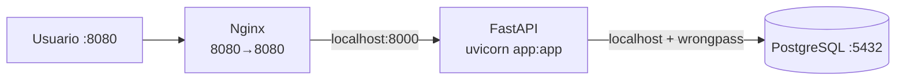
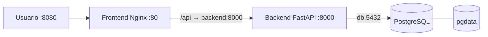

# Arquitectura inicial y final

## Arquitectura inicial

El paquete recibido contenía tres servicios, pero varias configuraciones impedían su funcionamiento coordinado.

| Componente | Configuración inicial problemática |
|---|---|
| Frontend | El host 8080 se dirigía al puerto interno 8080, aunque Nginx escuchaba en 80. |
| Proxy Nginx | `/api/` se enviaba a `localhost:8000`, que representaba al propio frontend. |
| Backend | Uvicorn intentaba importar `app:app`, aunque la aplicación estaba en `main.py`. |
| Dependencias | SQLAlchemy no disponía del controlador `psycopg2`. |
| Conexión a datos | La URL utilizaba `localhost`, donde no existía PostgreSQL dentro del backend. |
| Credenciales | La URL utilizaba `wrongpass`, mientras PostgreSQL estaba configurado con `rescue123`. |
| Persistencia | No existía un volumen nombrado declarado explícitamente en Compose. |
| Disponibilidad | `depends_on` solo controlaba orden de inicio; no verificaba que el servicio estuviera listo. |

## Arquitectura final

## Topología final

| Elemento | Configuración final |
|---|---|
| Red | Red predeterminada `catedra-2-especialidad_default`. |
| Acceso externo | Solo el frontend publica `${APP_PORT:-8080}:80`. |
| Frontend → backend | `http://backend:8000/` mediante DNS interno de Compose. |
| Backend → PostgreSQL | URL externalizada con host `db` y puerto interno 5432. |
| Persistencia | Volumen nombrado `pgdata` montado en `/var/lib/postgresql/data`. |
| Salud de PostgreSQL | `pg_isready` comprueba que acepte conexiones. |
| Salud del backend | `/health` comprueba FastAPI y una consulta real a PostgreSQL. |
| Orden de inicio | Backend espera a `db: healthy`; frontend espera a `backend: healthy`. |
| Configuración | `.env.example`, valores predeterminados en Compose y `.env` ignorado por Git. |

## Recorrido de una solicitud

1. El usuario accede al puerto publicado 8080.
2. Nginx sirve `index.html` o recibe una solicitud bajo `/api/`.
3. Nginx elimina el prefijo `/api/` y reenvía la solicitud a `backend:8000`.
4. FastAPI procesa la solicitud y SQLAlchemy se conecta a `db:5432`.
5. PostgreSQL lee o escribe los datos ubicados en el volumen `pgdata`.
6. La respuesta vuelve por FastAPI y Nginx hasta el cliente.

## Límites de la solución

- Está orientada a laboratorio y desarrollo; las credenciales de `.env.example` no deben utilizarse en producción.
- El volumen nombrado entrega persistencia local, pero no alta disponibilidad ni respaldo externo.
- La solución utiliza una única instancia de cada servicio.